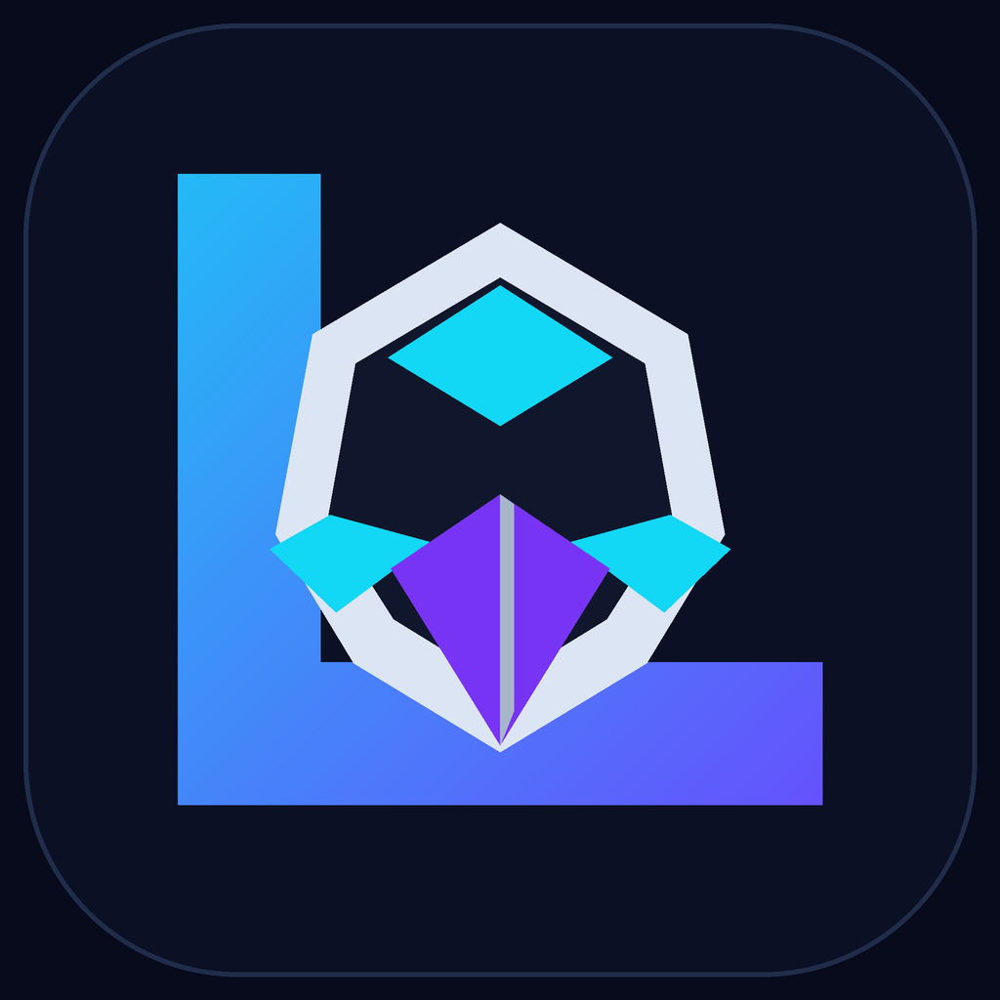

# Loki Agent — versão 0.4.0

Assistente Android open source com voz, contexto de conversa, ligações a modelos de IA e controlos do telemóvel sujeitos às permissões e confirmações do Android.

**Código-fonte completo:** [Loki-Agent-Android-v0.4.0.zip](./Loki-Agent-Android-v0.4.0.zip)  
**Logótipo vetorial:** [loki-agent-logo.svg](./loki-agent-logo.svg) · [PNG](./loki-agent-logo.png)

## O que mudou

- Mantém até 6 trocas de conversa em memória, para perguntas de seguimento; podes limpar o contexto no ecrã.
- Pode ligar diretamente à API Messages da Anthropic ou a endpoints compatíveis com OpenAI, usados por serviços como DeepSeek, Kimi/Moonshot e Ollama.
- Chave API opcional, escondida no campo e **não guardada** depois de fechares a sessão.
- Ajuda a escrever, rever e depurar código através do modelo ligado.
- Abre apps pelo nome visível, pesquisa na web, diz as horas e, com acessibilidade ativada, lê ecrãs e navega. Cada toque em elemento pede confirmação.
- Ícone e logótipo próprios do Loki Agent.

A qualidade e o custo dependem do modelo/serviço que configurares. O Loki Agent **não é uma cópia do Claude Code**: não tem terminal nem edita automaticamente projetos Android. As respostas dos modelos não são executadas como ações no dispositivo.

## Abrir no Android Studio

1. Extrai o ZIP e abre a pasta `LokiAgent` no Android Studio.
2. Instala JDK 17; aceita o download do Android Gradle Plugin e Android SDK 35.
3. Liga o telemóvel por USB (depuração USB) ou usa um emulador e carrega em **Run**.
4. Permite o microfone quando a app pedir.

## Obter o APK de teste

O workflow **Build Android APK** compila automaticamente a fonte e publica o APK de depuração como artefacto na execução do GitHub Actions. Abre [Actions](../../actions/workflows/build-android-apk.yml), escolhe a execução mais recente concluída e descarrega o artefacto `Loki-Agent-debug-APK`. O artefacto fica disponível por tempo limitado (normalmente 14 dias). É uma versão de depuração para testes, não uma versão de publicação assinada.

No Android Studio, também podes usar **Build → Build Bundle(s) / APK(s) → Build APK(s)**. O APK de depuração sai em `app/build/outputs/apk/debug/app-debug.apk`.

## Configurar um modelo

Preenche o endpoint completo, o ID do modelo e, se o serviço pedir, a chave API. Para Anthropic, escolhe o endpoint Messages da API; para DeepSeek, Kimi/Moonshot, Ollama ou gateways OpenAI-compatible, usa o endpoint documentado pelo respetivo fornecedor. O campo da chave não é persistido. Ollama pode correr num computador da tua rede; usa o endereço LAN desse computador, não `127.0.0.1` no telemóvel.

As mensagens e até 6 trocas anteriores são enviadas ao serviço configurado para manter contexto. Se não quiseres enviar dados para um serviço cloud, usa um modelo local com Ollama. Não exponhas uma instância Ollama diretamente à Internet.

## Controlos de acessibilidade

1. Toca em **Ativar / gerir acessibilidade** e ativa **Loki Agent — controlos autorizados** nas Definições.
2. Com outra app aberta, toca no microfone flutuante e diz, por exemplo: “lê o ecrã”, “desce”, “voltar” ou “toca em pesquisar”.
3. Confirma no diálogo antes de cada toque.

O serviço pode ler o texto que o Android expõe enquanto está ativo. Esse texto não é guardado nem enviado ao modelo por iniciativa da app; algumas apps ocultam conteúdo ou bloqueiam controlos. Não há palavra de ativação nem escuta contínua.

## Licença

MIT — ver [`LICENSE`](./LICENSE).
